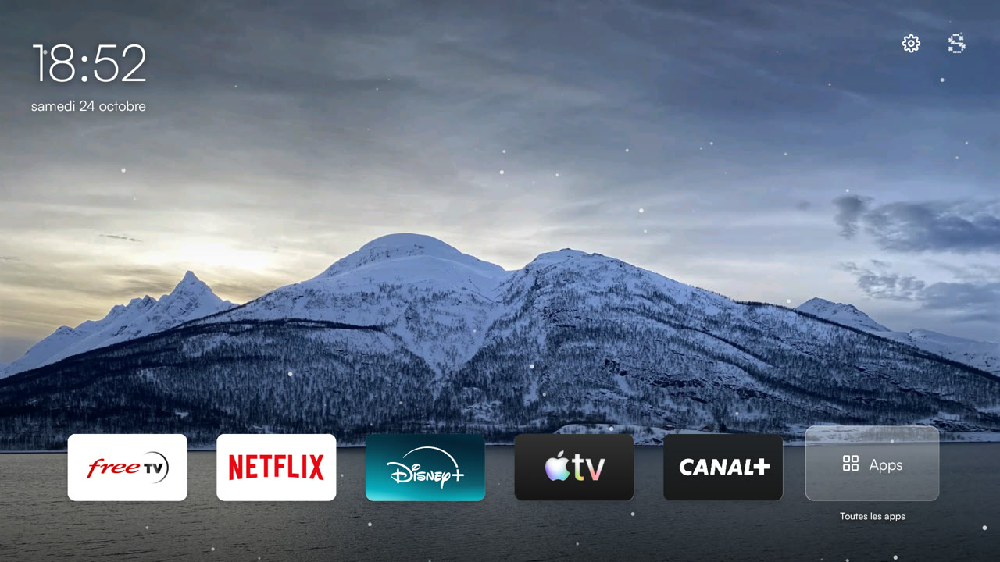
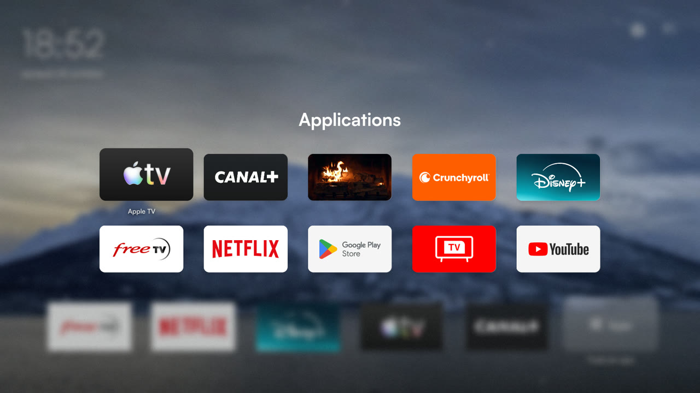

<p align="center">
  <a href="https://github.com/sway-agency/tv">
    <picture>
      <source media="(prefers-color-scheme: dark)" srcset=".github/assets/sway-logo-white.svg">
      
    </picture>
  </a>
</p>

<h1 align="center">Accueil: open source Android TV launcher</h1>

<p align="center">
  A fast, minimal and ad-free home screen for <strong>Android TV</strong> and <strong>Google TV</strong>.<br>
  Remove bloatware in one command, keep only your apps, and enjoy a cosy fireplace screensaver.
</p>

<p align="center">
  <a href="https://github.com/sway-agency/tv/actions/workflows/ci.yml"></a>
  <a href="LICENSE"></a>
  
  
</p>

<p align="center">
  
  
</p>

## Why Accueil?

Stock Android TV launchers are slow, full of ads and sponsored rows, and TV makers preload apps you never use. Accueil replaces the home screen with something calm and quick, and cleans up the TV safely:

- **No ads, no sponsored content, no tracking.** Just your apps.
- **Lightweight.** Plain Java, no Gradle, no AndroidX, no library. Runs smoothly on 2 GB TVs.
- **One-command debloat.** Disable manufacturer bloatware and unused Google services, fully reversible, no root.
- **Set up by AI.** Give the repository link to Claude Code or any coding agent and it installs everything, asking you which apps to keep.
- **Controlled by AI.** An optional, hardened MCP server lets your personal AI agent or voice assistant drive the TV, safely.

## Features

- Custom app dock, in your order, changed over ADB without rebuilding
- Full app grid with every installed TV app
- Big clock and date, quick settings shortcut
- Winter, mountain and Christmas wallpapers changing every 20 minutes, with a slow zoom and pan
- Organic spring animations and light snowfall
- Fireplace with crackling sound, as an app and as the system screensaver (daydream)
- Debloat lists per TV brand, shared by the community
- Privacy audit: see and revoke which apps can use the microphone, a camera or the location
- Optional AI remote control over MCP: Claude, Hermes Agent, OpenJarvis, voice assistants

## Install with an AI agent (easiest)

1. On the TV, enable developer options: **Settings**, **Device preferences**, **About**, press **Build** 7 times. Then turn on **USB debugging** and **network debugging** in **Developer options**.
2. Open [Claude Code](https://claude.com/claude-code), or any coding agent, and say:

   > Install https://github.com/sway-agency/tv on my TV

The agent follows [`CLAUDE.md`](CLAUDE.md): it connects over ADB, installs the launcher, replaces the stock home screen, then asks you which apps to disable and which to pin in the dock.

## Install manually

Requirements: macOS with Homebrew (or any OS with JDK 17, the Android SDK and `adb`), and the TV IP address.

```sh
git clone https://github.com/sway-agency/tv.git && cd tv
make setup
make connect TV=192.168.1.20
make quick TV=192.168.1.20
make apps TV=192.168.1.20
make debloat TV=192.168.1.20
make dock TV=192.168.1.20 DOCK="com.netflix.ninja com.disney.disneyplus"
```

| Command | What it does |
| --- | --- |
| `make setup` | Installs JDK 17, the Android SDK, ADB and ffmpeg with Homebrew |
| `make connect` | Connects to the TV over ADB (accept the prompt on the TV) |
| `make quick` | Builds, installs, sets Accueil as home and the fireplace as screensaver |
| `make apps` | Lists installed apps and the packages recommended for removal |
| `make debloat` | Disables the recommended packages, or only `PACKAGES="..."` |
| `make dock` | Sets the dock apps, in order |
| `make restore` | Re-enables everything disabled from this repository |
| `make privacy` | Lists apps allowed to use the microphone, a camera or the location |
| `make privacy-lock` | Revokes those permissions from `PACKAGES="..."` |

Outside macOS, set `ANDROID_SDK` (with `build-tools;36.0.0` and `platforms;android-36`) and `ACCUEIL_JDK` (JDK 17). Run `make help` for every target.

## Control the TV with your AI agent

`accueil-bridge` is a small MCP server (Go, zero dependencies, 20 MB of RAM) that runs on a machine at home and lets an AI agent press remote keys, open apps, turn the screen on or off or start the fireplace. TLS 1.3, per-agent tokens with scopes, rate limiting, no camera or microphone access, no shell, never exposed to the internet: remote access goes through WireGuard on your box.

```sh
make bridge-init TV=192.168.1.20 LISTEN=192.168.1.10:8443 HOSTS="192.168.1.10"
make bridge-token NAME=claude
make bridge-serve
```

Full guide, security model and agent setup: [`docs/bridge.md`](docs/bridge.md).

## How to remove bloatware from an Android TV

Accueil ships curated lists of packages that are safe to disable, in [`config/packages`](config/packages): `common.txt` for every Android TV, plus one file per brand. `make debloat` uses `pm disable-user`, so nothing is uninstalled and `make restore` brings everything back. No root, no warranty void, no factory reset.

## Supported TVs

Any Android TV or Google TV running Android 9 or newer: TCL, Sony Bravia, Philips, Hisense, Xiaomi Mi TV, Nvidia Shield, Chromecast with Google TV and more. Brands with a dedicated debloat list today: **TCL**.

Your brand is missing? The AI agent writes the list with you and opens a pull request. See [`CONTRIBUTING.md`](CONTRIBUTING.md).

## FAQ

**Is it safe?** Yes. Apps are disabled, never uninstalled, and the lists only contain packages tested on real TVs. `make restore` undoes everything.

**Does it need root?** No. Only ADB debugging, available on every Android TV.

**Can I go back to the original launcher?** Yes. Run `make restore`, then uninstall Accueil from the TV settings.

**Does it work on Google TV?** Yes. The Google TV home is disabled like any other stock launcher, and can be restored.

**Can an AI agent control the TV remotely?** Yes, with `accueil-bridge`. It is never exposed to the internet: use the WireGuard VPN of your box to reach it from outside. See [`docs/bridge.md`](docs/bridge.md).

**Can I change the wallpapers or the fireplace?** Yes. Drop JPEG files in `assets/wallpapers/`, or replace `assets/fireplace/fire.mp4`, then run `make quick`.

## Customising

- **Dock**: `make dock`, no rebuild needed
- **Wallpapers**: any JPEG in `assets/wallpapers/`, interval in `WallpaperRotator.java`
- **Font**: add a variable font at `assets/fonts/satoshi.ttf`, otherwise the system sans-serif is used
- **Fireplace**: `make fireplace` downloads a CC0 fire loop on first build

Keep your `accueil.keystore`: Android refuses to update the app when it is signed with another key.

## Contributing

Contributions are welcome, especially debloat lists for new TV brands. Read [`CONTRIBUTING.md`](CONTRIBUTING.md) and the code norm [`NORME.md`](NORME.md). The norminette (`python3 scripts/norminette.py`) and a build run on every pull request.

## Licence

Code under the [MIT licence](LICENSE). The Sway name and logos are trademarks of Sway: they may only be redistributed unmodified, where this project displays them. Wallpapers, sounds and icons keep their own licences, listed in [`CREDITS.txt`](CREDITS.txt).

<p align="center">Made with care by <strong>Sway</strong>.</p>
